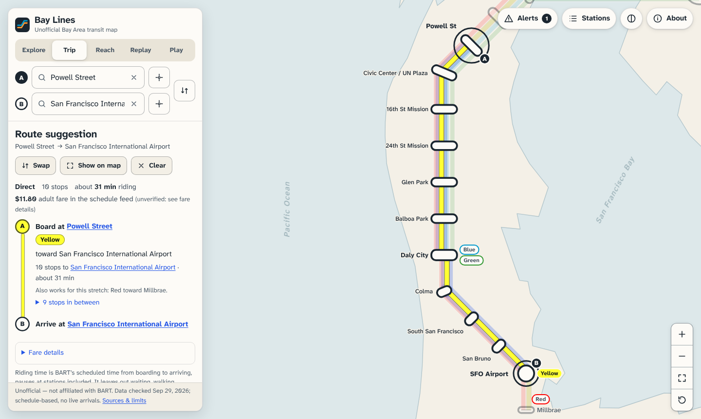
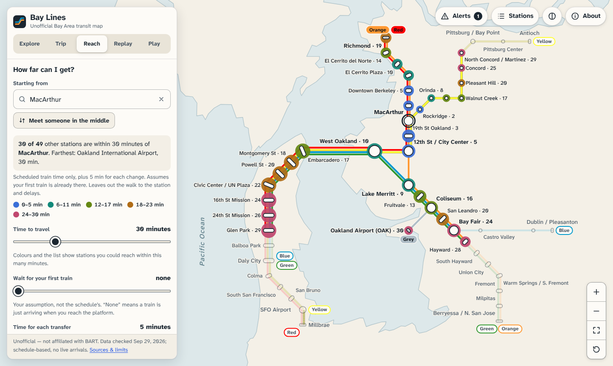

# Bay Lines

[](https://github.com/TheMambi/bay-lines/actions/workflows/ci.yml)
[](LICENSE)

An unofficial, interactive map of the BART network. It suggests routes, shows how far you can get in a set time, replays the published timetable as moving trains, and has two small games. Everything runs on BART's published schedule data, and service alerts come from BART's realtime feed through a small serverless proxy.

**Live:** https://bay-lines.vercel.app



> Not affiliated with or endorsed by Bay Area Rapid Transit (BART). The line diagram is an original schematic, not BART's system map, and the app uses no BART logos.

## What it does

| Mode        | What you get                                                                                                                                                                 |
| ----------- | ---------------------------------------------------------------------------------------------------------------------------------------------------------------------------- |
| **Explore** | Search stations by name, code or nickname ("SFO", "Ferry Building"), highlight a line, see which lines run in a given service (weekday, Saturday, Sunday, day or evening).   |
| **Trip**    | Route suggestions between any two stations that follow real stopping patterns, with transfers, riding time, stops in between, alternatives and the fare table from the feed. |
| **Reach**   | A travel-time heat map from one station, or the fairest place for two people to meet. Transfer time and first wait are your own assumptions, shown as sliders.               |
| **Replay**  | Every trip in the weekday, Saturday or Sunday timetable, drawn as moving trains. Clearly marked as scheduled, not live.                                                      |
| **Play**    | _Station Sprint_ (find stations with the names hidden) and _Guess the Ride_ (estimate scheduled ride times), with a shared daily set.                                        |



Accessibility was a design goal: keyboard navigation across the map (arrow keys move between stations), screen-reader announcements for every state change, a plain-text station list, reduced-motion support, and light and dark themes.

## How it works

- **Network model** (`src/lib/network.js`): stations, lines and stopping patterns come from BART's GTFS feed. A pattern counts as regular service only if it runs at least a quarter as often as the busiest pattern on its line and direction, so a single late-night trip that skips a station doesn't create a fake direct train.
- **Routing** (`src/lib/routing.js`, `src/lib/graph.js`): Dijkstra over a graph with one node per station and one node per stop of each pattern, so trains only go where they actually stop. Alternatives come from re-running the search with one line or transfer station excluded; an alternative is kept if its ranking cost is within 25 minutes of the best route. With the "Right now" service the search also knows the time: a train is left out at a stop once its last run of the day has left there, or will leave before the rider could arrive. A service you pick yourself ignores the clock.
- **Reach** (`src/lib/reach.js`): the same graph and search, single-source, so each station gets the route the trip planner would suggest. Your transfer and first-wait assumptions are added to that route's time and never change which route is picked.
- **Schematic map** (`src/map/`): hand-placed station layout, offset lanes per line, and a label placer that tries eight anchor directions per label and scores collisions with markers, track and other labels.
- **Replay** (`src/lib/replay.js`): positions each scheduled trip from its departure time and the pattern's typical stop-to-stop times, driven by a small clock that React subscribes to with `useSyncExternalStore`.
- **Alerts** (`api/alerts.js`): a Vercel Function fetches BART's GTFS-Realtime alerts feed (protobuf), decodes it to JSON and lets the CDN cache it for 60 seconds, so traffic to the app doesn't turn into traffic to BART.

## Tech

React 19, Vite, plain CSS, SVG for the map. No map library and no UI framework. Vitest for unit tests, ESLint and Prettier for code style. Deployed on Vercel.

## Run it locally

```bash
npm install
npm run dev      # http://localhost:5173, alerts proxy included
npm test         # unit tests
npm run lint
npm run build && npm run preview
```

Node 20 or newer.

## Project layout

```
api/                 Vercel Function for service alerts (+ GTFS platform-to-station map)
src/
  App.jsx            app shell, mode switching, URL hash state
  components/        panels, dialogs, station card, games
  hooks/             alerts polling, pan/zoom, media queries, replay clock
  lib/               network model, routing, reach, time, search, formatting
  map/               schematic layout, geometry, label placement, SVG layers
  data/              network.json (from BART GTFS), geography.json (Natural Earth)
test/                unit tests
docs/                README screenshots, known pitfalls (PITFALLS.md)
.github/             CI workflow and Dependabot config
```

## Security

The site sends a strict Content-Security-Policy, the alerts function accepts no caller input and caps what it reads from BART, and CI runs `npm audit` on every push. See [SECURITY.md](SECURITY.md) for the details and for how to report a problem privately.

## Data and licences

- **Schedule data** (`src/data/network.json`) is derived from BART's [static GTFS feed](https://www.bart.gov/schedules/developers/gtfs), version 72, last checked on September 29, 2026. Transit data is © Bay Area Rapid Transit and used under the [BART Developer License Agreement](https://www.bart.gov/dla). The current schedule's calendar runs to January 10, 2027. After that date the app keeps working, shows the old timetable, and says in the footer and in the About text that the timetable has ended. `npm test` starts failing 30 days before the end as a reminder to rebuild the data from a newer feed.
- **Service alerts** come from BART's [GTFS-Realtime feed](https://www.bart.gov/schedules/developers/gtfs-realtime), which needs no API key.
- **Station details** such as addresses, connecting services and elevator information are not reproduced. Each station card links to BART's own page, which stays current.
- **Land outline** (`src/data/geography.json`) is generalised from [Natural Earth](https://www.naturalearthdata.com/) 1:10m data, which is public domain.
- **Typeface:** Atkinson Hyperlegible Next, SIL Open Font License 1.1.

Copyright (C) 2026 TheMambi. This program is free software: you can redistribute it and/or modify it under the terms of the GNU Affero General Public License as published by the Free Software Foundation, either version 3 of the License, or (at your option) any later version. See `LICENSE` for the full text.

The AGPL licence covers the source code only. Three generated data files are not covered by it: `src/data/network.json` and `api/_lib/stop-parents.js` are derived from BART's GTFS feed and used under the BART Developer License Agreement, and `src/data/geography.json` is derived from Natural Earth data, which is public domain.

The script that builds those three files is not in this repository yet, so they cannot be rebuilt from a fresh clone.
